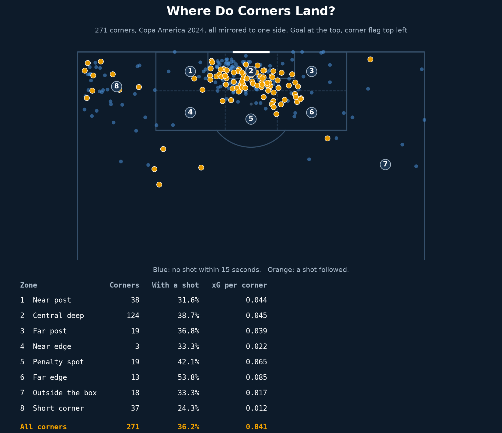
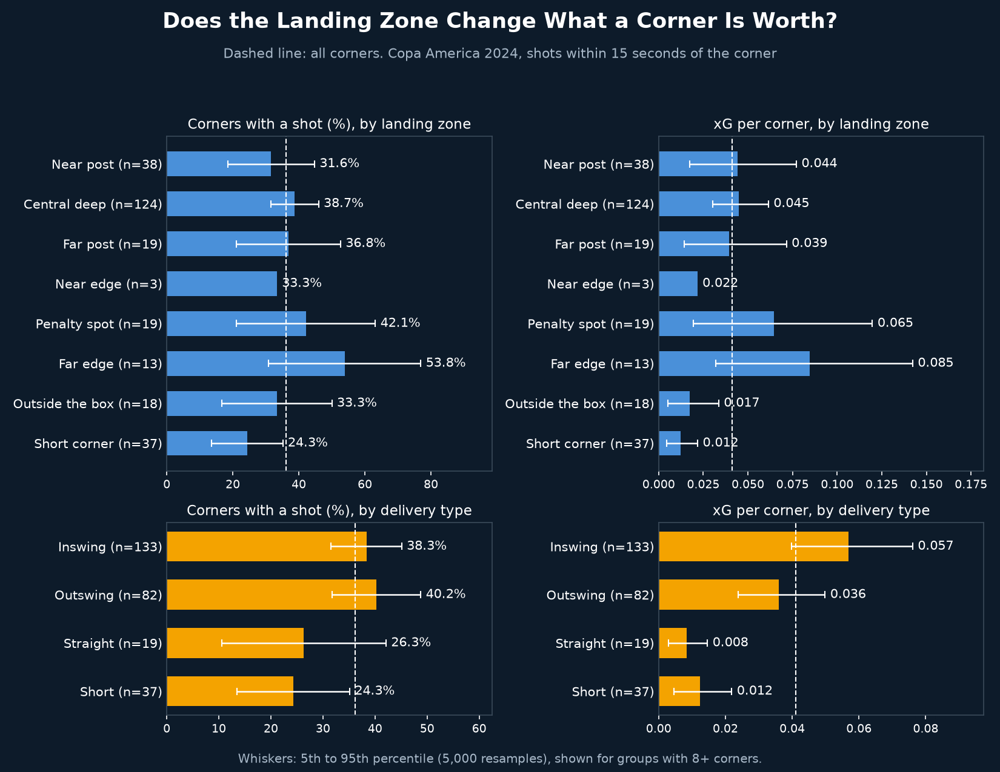

# Corner Delivery Map

## Why
Everyone agrees corners matter, but what happens after one depends on where the ball lands and how it is delivered. This project maps every corner at Copa America 2024 to a landing zone and delivery type, then links each one to the shots that followed.

## What it does
- Finds every corner (271 in 32 matches, periods 1 to 4, shootouts excluded) and mirrors them to one side of the pitch
- Places each delivery in one of 8 landing zones: near post, central deep, far post, near edge, penalty spot, far edge, outside the box, short corner
- Types each corner as inswing, outswing, straight or short (under 20 yards)
- Links corners to non-penalty shots by the same team in the same possession within 15 seconds, so second balls count
- Reports share of corners with a shot and xG per corner, with a 5th to 95th percentile range from 5,000 bootstrap resamples for groups with 8+ corners
- Replays Argentina's 32 corners one at a time, with zone counts and running xG

## Key findings

| Landing zone | Corners | With a shot | xG per corner (5th to 95th) |
|---|---|---|---|
| Near post | 38 | 31.6% | 0.044 (0.02 to 0.08) |
| Central deep | 124 | 38.7% | 0.045 (0.03 to 0.06) |
| Far post | 19 | 36.8% | 0.039 (0.01 to 0.07) |
| Near edge | 3 | 33.3% | 0.022 (too few for a range) |
| Penalty spot | 19 | 42.1% | 0.065 (0.02 to 0.12) |
| Far edge | 13 | 53.8% | 0.085 (0.03 to 0.14) |
| Outside the box | 18 | 33.3% | 0.017 (0.01 to 0.03) |
| Short corner | 37 | 24.3% | 0.012 (0.00 to 0.02) |
| All corners | 271 | 36.2% | 0.041 |

| Delivery type | Corners | With a shot | xG per corner (5th to 95th) |
|---|---|---|---|
| Inswing | 133 | 38.3% | 0.057 (0.04 to 0.08) |
| Outswing | 82 | 40.2% | 0.036 (0.02 to 0.05) |
| Straight | 19 | 26.3% | 0.008 (0.00 to 0.01) |
| Short | 37 | 24.3% | 0.012 (0.00 to 0.02) |

- 98 of 271 corners (36.2%) had a shot within 15 seconds, 111 shots and 10 goals in total, for 0.041 xG per corner, or about 24 corners per xG
- Inside the box the landing zone did not clearly change the value: central deep, near post and far post all overlap the average. Far edge and penalty spot look best but have 13 and 19 corners, so their ranges are wide
- Short corners (0.012) and straight deliveries (0.008) were clearly below the average
- Inswingers produced 0.057 xG per corner against 0.036 for outswingers. Shot rates were almost the same, so inswingers made better shots, about 0.13 xG per shot against about 0.08 (approximate, from the table). The ranges overlap slightly
- 8 of the 10 goals came from inswingers, but 10 goals is too few to lean on
- Argentina took 32 corners: 7 had a shot (22%) and they produced 1.61 xG, or 0.050 per corner

## Limitations
- 271 corners, so most zones have few corners and the ranges are wide
- Corners with no end location are dropped
- xG measures the shots that followed, not the quality of the delivery. The data has no blocking, runs or marking, and does not show who won the first contact
- A zone may look good because stronger teams aim there more often
- The 15-second window is a choice. Blocked shots and second balls are included, so the shot rate is not comparable with figures from other sources
- Landing zones are drawn by hand and the zone boundaries affect the counts
- Extra time is included and shootouts are excluded

## Visual

*All 271 corners mirrored to one side. Orange: a shot followed within 15 seconds. The table shows each zone.*

*Share of corners with a shot and xG per corner by landing zone and by delivery type. Dashed line: all corners.*

`corner_replay.mp4` replays Argentina's corners one at a time and ends with both charts.

## Tools
Python, pandas, NumPy, matplotlib, imageio-ffmpeg

## Data source
StatsBomb open data, Copa America 2024 (32 matches). Corner passes only, penalties excluded.
